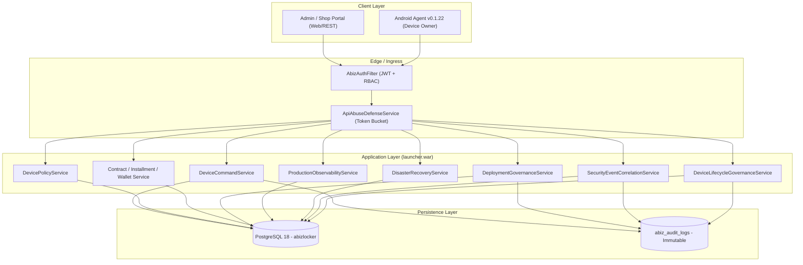

# 01 — SYSTEM ARCHITECTURE SPECIFICATION
## ABIZ LOCKER Enterprise Device Financing & MDM Security Platform (Release 22.0.0)

---

### 1. Architectural Overview
ABIZ LOCKER is an enterprise-grade, multi-tenant mobile device management (MDM) and device financing control platform designed for secure installment financing. It enforces strict hardware-level locking, cryptographic command delivery, non-custodial double-entry ledgers, automated disaster recovery, and real-time security operations.



---

### 2. Multi-Tenant Authorization Model
The system enforces strict tenant isolation using `AbizTenantContext` and `AbizRole`:
- `SUPER_ADMIN`: Global platform oversight, deployment release approval, production freeze management, cross-tenant disaster recovery.
- `SHOP_OWNER`: Full administration within bounded tenant (`shop_id`), financing contract creation, customer management, credit purchase.
- `SHOP_STAFF`: Customer onboarding, device enrollment, payment entry. Blocked from administrative commands (`WIPE`, `CHANGE_SHOP`).
- `CUSTOMER`: Read-only access to assigned contract installment schedules and payment receipts.

---

### 3. Cryptographic Command Execution Invariant
Every device state transition or MDM command adheres to the master fail-closed security invariant:
```text
COMMAND_EXECUTION IFF AUTHENTICATED AND AUTHORIZED AND TENANT_BOUND AND DEVICE_BOUND AND IDENTITY_VERIFIED AND NOT_COMPROMISED AND PROTOCOL_COMPATIBLE AND NOT_EXPIRED AND STATE_VALID AND NONCE_UNIQUE AND PAYLOAD_INTEGRITY_VALID AND SIGNATURE_VALID AND RATE_LIMIT_VALID AND POLICY_VALID AND LEASE_VALID AND IDEMPOTENT AND AUDITED AND OBSERVABLE AND RECOVERABLE AND DEPLOYMENT_SAFE AND CONFIGURATION_APPROVED
```

---

### 4. Background Workers & Coordination
- `CommandReconciliationWorker`: Sweeps expired commands, recovers stuck dispatching transitions, and routes persistent failures to dead-letter storage.
- `WorkerHeartbeatCoordinator`: Distributes background tasks across worker nodes using leader leases to prevent duplicate command dispatch.
- `DisasterRecoveryService`: Evaluates backup freshness, coordinates point-in-time recovery metadata, and guarantees RTO ≤ 300s, RPO ≤ 60s.
