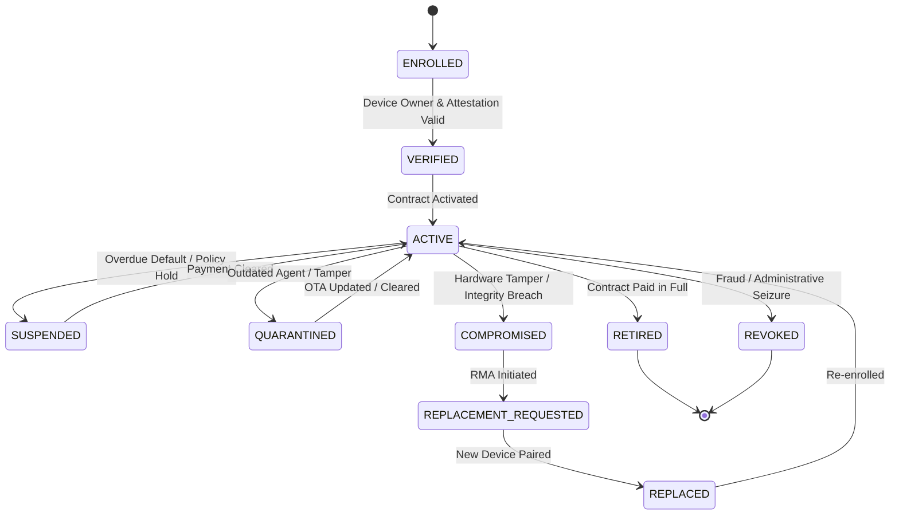

# 06 — DEVICE LIFECYCLE OPERATIONS RUNBOOK
## 10-State Finite State Machine (FSM) Governance

---

### 1. Lifecycle State Machine Diagram
The device lifecycle is strictly governed by `DeviceLifecycleGovernanceService`:

---

### 2. State Definitions & Transitions

| State | Operational Meaning | Allowed Next States |
|---|---|---|
| `ENROLLED` | Device registered in system, awaiting Device Owner attestation. | `VERIFIED` |
| `VERIFIED` | Device Owner active, cryptographic identity validated. | `ACTIVE` |
| `ACTIVE` | Under active financing contract, MDM policy enforced. | `SUSPENDED`, `QUARANTINED`, `COMPROMISED`, `RETIRED`, `REVOKED` |
| `SUSPENDED` | Device locked due to non-payment or administrative hold. | `ACTIVE` |
| `QUARANTINED` | Version deprecated or abnormal network behavior isolated. | `ACTIVE` |
| `COMPROMISED` | Rooting, bootloader unlock, or replay attack detected. | `REPLACEMENT_REQUESTED` |
| `REPLACEMENT_REQUESTED` | RMA workflow initiated for damaged/compromised hardware. | `REPLACED` |
| `REPLACED` | Serial swap recorded in database. | `ACTIVE` |
| `RETIRED` | Terminal state: Contract fully paid, MDM lock removed permanently. | None (Terminal) |
| `REVOKED` | Terminal state: Fraud blacklist / permanent decommissioning. | None (Terminal) |

---

### 3. Illegal Transition Defense
Any transition outside the defined matrix (e.g. `REVOKED` → `ACTIVE` or `RETIRED` → `ACTIVE`) is immediately rejected by `DeviceLifecycleGovernanceService.isValidTransition(...)` and logged as a security alert.
