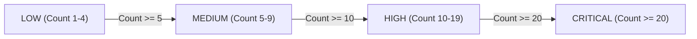

# 10 — SECURITY OPERATIONS & INCIDENT RESPONSE RUNBOOK
## Real-Time Threat Correlation & Severity Escalation

---

### 1. Incident Aggregation & Fingerprinting
`SecurityEventCorrelationService` ingests security telemetry across workers, gateways, and mobile agents. Every event is hashed into a SHA-256 fingerprint:
```text
Fingerprint = SHA256(shopId + ":" + deviceId + ":" + eventType + ":" + source)
```
Duplicate events within active windows increment `occurrence_count` rather than generating redundant database rows.

---

### 2. Automated 4-Tier Severity Escalation



- **LOW:** Isolated transient signature mismatch or clock jitter.
- **MEDIUM:** Repeated token replay attempt or rapid rate limit breach.
- **HIGH:** Device attestation failure or unauthorized administrative command attempt.
- **CRITICAL:** Cross-tenant access attempt, Device Owner removal attempt, or rooted device detection. Automatically places device into `QUARANTINED` or `COMPROMISED` lifecycle state.
