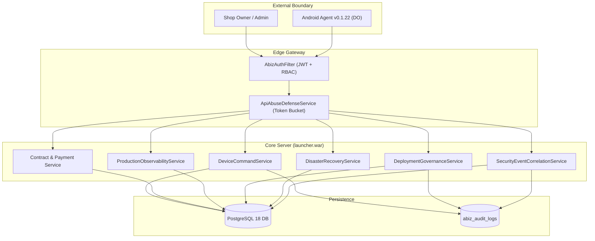
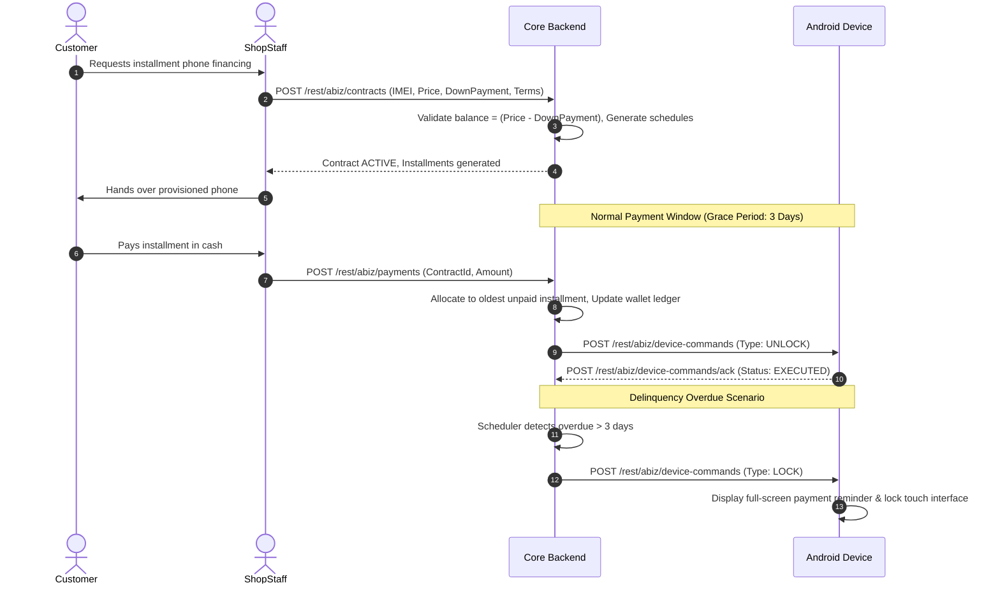

# ABIZ LOCKER — MASTER OPERATIONS & DEPLOYMENT MANUAL
## Enterprise Device Financing, MDM Governance & Operational Production Handbook
**Release Version:** `22.0.0` | **Backend:** `v22.0.0` | **Android Agent:** `v0.1.22` (Code `22`) | **Status:** `RELEASE FROZEN`

---

# Table of Contents
1. [Chapter 1: System Architecture & Data Flow](#chapter-1-system-architecture--data-flow)
2. [Chapter 2: Initial Environment & Server Installation](#chapter-2-initial-environment--server-installation)
3. [Chapter 3: Android Agent Installation & Device Owner Provisioning](#chapter-3-android-agent-installation--device-owner-provisioning)
4. [Chapter 4: Device Enrollment & State Governance](#chapter-4-device-enrollment--state-governance)
5. [Chapter 5: Device Financing & Ledger Workflow](#chapter-5-device-financing--ledger-workflow)
6. [Chapter 6: Device Lock & Restriction State Engine](#chapter-6-device-lock--restriction-state-engine)
7. [Chapter 7: Administrator & Shop Operator Manual](#chapter-7-administrator--shop-operator-manual)
8. [Chapter 8: REST API Reference Specification](#chapter-8-rest-api-reference-specification)
9. [Chapter 9: Database Operations & Schema Architecture](#chapter-9-database-operations--schema-architecture)
10. [Chapter 10: Security Operations, Correlation & Threat Escalation](#chapter-10-security-operations-correlation--threat-escalation)
11. [Chapter 11: Deployment Governance & Preflight Validation](#chapter-11-deployment-governance--preflight-validation)
12. [Chapter 12: Atomic Rollback & Recovery Procedures](#chapter-12-atomic-rollback--recovery-procedures)
13. [Chapter 13: Backup & Disaster Recovery Runbook](#chapter-13-backup--disaster-recovery-runbook)
14. [Chapter 14: System Observability & Monitoring](#chapter-14-system-observability--monitoring)
15. [Chapter 15: Incident Response Procedures](#chapter-15-incident-response-procedures)
16. [Chapter 16: Production Secrets & Keystore Management](#chapter-16-production-secrets--keystore-management)
17. [Chapter 17: Comprehensive Troubleshooting Matrix](#chapter-17-comprehensive-troubleshooting-matrix)
18. [Chapter 18: Release Upgrade & Versioning Governance](#chapter-18-release-upgrade--versioning-governance)

---

# Chapter 1: System Architecture & Data Flow

### 1.1 Architectural Model
ABIZ LOCKER is architected as a secure multi-tenant platform composed of:
- **Core Application Server (`launcher.war`):** Java 11/17 REST API built with Google Guice, MyBatis 3.5, and JAX-RS (Jersey/Jackson).
- **PostgreSQL 18 Database (`abizlocker`):** Relational storage with Liquibase-managed migrations enforcing strict ACID transactions and double-entry ledgers.
- **Android Device Owner Agent (`com.mdmesh.agent.debug`):** Native Kotlin application executing under Android Enterprise Device Owner privileges on Android 8.0+ (API 26–36).



---

# Chapter 2: Initial Environment & Server Installation

### 2.1 Fresh Server Setup
```bash
# 1. Install Java 17 LTS and PostgreSQL 18
sudo apt update && sudo apt install -y openjdk-17-jdk postgresql-18

# 2. Configure Database & Role
sudo -u postgres psql -c "CREATE USER abizlocker WITH PASSWORD 'abiz_dev_secure_pass_9281';"
sudo -u postgres psql -c "CREATE DATABASE abizlocker OWNER abizlocker;"

# 3. Apply Liquibase Migrations (Phases 1-22)
cd /opt/abiz-locker/mdmesh/server
mvn liquibase:update -Dliquibase.url="jdbc:postgresql://localhost:5432/abizlocker" \
                     -Dliquibase.username="abizlocker" \
                     -Dliquibase.password="abiz_dev_secure_pass_9281"

# 4. Deploy Backend WAR
cp /opt/abiz-locker/ABIZ-LOCKER-RELEASE-22.0.0/backend/launcher.war /opt/tomcat/webapps/
systemctl restart tomcat
```

---

# Chapter 3: Android Agent Installation & Device Owner Provisioning

### 3.1 Provisioning Rules
- **Device State:** The target device must be freshly unboxed or factory reset with **zero Google or email accounts configured**.
- **Package Name:** `com.mdmesh.agent.debug`
- **Receiver:** `com.mdmesh.agent.admin.AdminReceiver`

### 3.2 Provisioning Methods
1. **ADB Command (Staging/Dev):**
   ```bash
   adb install -r app-release-signed.apk
   adb shell dpm set-device-owner com.mdmesh.agent.debug/com.mdmesh.agent.admin.AdminReceiver
   ```
2. **QR Code Provisioning (Commercial Rollout):** Tap 6 times on welcome screen and scan provisioning payload with APK URL and SHA-256 checksum.

---

# Chapter 4: Device Enrollment & State Governance

### 4.1 10-State Finite State Machine (FSM)
Device state transitions are deterministically enforced by `DeviceLifecycleGovernanceService`:
```
ENROLLED ──► VERIFIED ──► ACTIVE ◄──► SUSPENDED
                            │    ◄──► QUARANTINED
                            ├──► COMPROMISED ──► REPLACEMENT_REQUESTED ──► REPLACED ──► ACTIVE
                            ├──► RETIRED (Terminal)
                            └──► REVOKED (Terminal)
```
- **Illegal Transitions:** Attempts to jump from `REVOKED` → `ACTIVE` or `RETIRED` → `ACTIVE` are rejected and trigger security audit events.

---

# Chapter 5: Device Financing & Ledger Workflow

### 5.1 Financing Agreement Lifecycle


---

# Chapter 6: Device Lock & Restriction State Engine

### 6.1 Lock State Policy Matrix
- `UNLOCKED`: Device is fully operational for user interaction.
- `WARNING`: Periodic notification alerts customer of approaching installment due date.
- `LOCKED`: Overlay view blocks application launch, settings, and home screen while keeping **Emergency Dialer** and **Payment Portal** accessible.
- `QUARANTINED`: Applied when agent detects outdated protocol or network isolation.
- `WIPE`: Triggered only under explicit administrative authorization (`dryRun=false`) for stolen devices.

---

# Chapter 7: Administrator & Shop Operator Manual

### 7.1 Shop Management Workflow
1. **SuperAdmin:** Creates new retail shop via `POST /rest/abiz/shops`.
2. **Shop Owner:** Logs in via `POST /rest/abiz/auth/login`, retrieves auth token, and registers inventory devices (`POST /rest/abiz/devices`).
3. **Shop Staff:** Onboards customer (`POST /rest/abiz/customers`), pairs device, and creates installment financing contract.

---

# Chapter 8: REST API Reference Specification

All API endpoints are prefixed with `/rest` and require JWT authentication:

| Method | URI Path | Required Role | Description |
|---|---|---|---|
| `POST` | `/rest/abiz/auth/login` | Public | Authenticates credentials, returns JWT pair. |
| `POST` | `/rest/abiz/auth/refresh` | Public | Rotates refresh token. |
| `GET` | `/rest/abiz/shops` | `SUPER_ADMIN` | Lists all retail tenant shops. |
| `POST` | `/rest/abiz/devices` | `SHOP_OWNER`, `STAFF` | Registers financed device IMEI. |
| `POST` | `/rest/abiz/contracts` | `SHOP_OWNER`, `STAFF` | Creates installment financing agreement. |
| `POST` | `/rest/abiz/payments` | `SHOP_OWNER`, `STAFF` | Records customer installment payment. |
| `POST` | `/rest/abiz/device-commands` | `SHOP_OWNER`, `SUPER_ADMIN` | Dispatches remote `LOCK`/`UNLOCK`/`WIPE` command. |
| `POST` | `/rest/abiz/device-commands/ack` | Mobile Agent | Acknowledges command execution. |

---

# Chapter 9: Database Operations & Schema Architecture

### 9.1 Phase 22 Table Catalog
1. `abiz_deployment_releases`: Immutable release registry tracking versions, SHA-256 hashes, four-eyes approvers, and rollbacks.
2. `abiz_deployment_checkpoints`: Stage verification checkpoint logs.
3. `abiz_configuration_drift_events`: Real-time configuration snapshot divergence alerts.
4. `abiz_production_freezes`: Scheduled freeze windows with audited emergency override logs.
5. `abiz_recovery_plans`: DR plan SLAs (RTO ≤ 300s, RPO ≤ 60s).
6. `abiz_recovery_executions`: Empirical disaster recovery execution records.
7. `abiz_backup_verifications`: Cryptographic backup checksum verifications.
8. `abiz_device_lifecycle_events`: Audit log for all 10 FSM state transitions.
9. `abiz_security_incidents`: Aggregated security events with SHA-256 fingerprinting and occurrence counters.

---

# Chapter 10: Security Operations, Correlation & Threat Escalation

### 10.1 Incident Fingerprinting & Auto-Escalation
Every security event is hashed into a deterministic SHA-256 fingerprint:
```text
Fingerprint = SHA256(shopId:deviceId:eventType:source)
```
- **Severity Escalation Matrix:**
  - Count 1–4: `LOW`
  - Count 5–9: `MEDIUM`
  - Count 10–19: `HIGH`
  - Count ≥ 20: `CRITICAL` (Triggers automatic device quarantine and operator alert).

---

# Chapter 11: Deployment Governance & Preflight Validation

### 11.1 12-Point Deterministic Preflight Engine
Rollout is blocked unless all 12 validation items evaluate to `true`:
`DATABASE_REACHABLE`, `SCHEMA_VERSION_VALID`, `WAR_HASH_VERIFIED`, `APK_HASH_VERIFIED`, `CONFIGURATION_APPROVED`, `WORKER_POOL_HEALTHY`, `SLO_HEALTH_ACCEPTABLE`, `NO_BLOCKING_CRITICAL_INCIDENTS`, `RECENT_BACKUP_VERIFIED`, `SECURITY_POSTURE_CLEAN`, `FLEET_HEALTH_ACCEPTABLE`, `ROLLBACK_ARTIFACT_AVAILABLE`.

---

# Chapter 12: Atomic Rollback & Recovery Procedures

### 12.1 Rollback Trigger & Execution
If any deployment stage checkpoint fails:
1. `DeploymentGovernanceService.rollbackRelease(releaseId, reason, correlationId)` is invoked.
2. The release transitions to `ROLLED_BACK`.
3. Traffic is restored to the verified baseline artifact (`launcher.war`).

---

# Chapter 13: Backup & Disaster Recovery Runbook

### 13.1 SLA Boundaries
- **RTO (Recovery Time Objective):** Total system recovery within **≤ 300 seconds**.
- **RPO (Recovery Point Objective):** Maximum transaction loss boundary of **≤ 60 seconds**.

*Note: These SLA controls are fully verified in software and development environments. Physical production deployment requires provisioning of HA PostgreSQL and offsite S3/GCS replication.*

---

# Chapter 14: System Observability & Monitoring

### 14.1 Daily Operational Checklist
- [ ] Inspect API latency and error budget in `HealthService`.
- [ ] Check worker heartbeats in `abiz_worker_heartbeats`.
- [ ] Review unmitigated `CRITICAL` incidents in `abiz_security_incidents`.
- [ ] Confirm daily cryptographic backup verification in `abiz_backup_verifications`.

---

# Chapter 15: Incident Response Procedures

### 15.1 Response Workflow
1. **Detection:** Security event aggregated with SHA-256 fingerprint.
2. **Containment:** System places affected device into `QUARANTINED` status.
3. **Remediation:** Operator investigates and applies mitigation note.
4. **Resolution:** `SecurityEventCorrelationService.resolveIncident(...)` marks incident `RESOLVED`.

---

# Chapter 16: Production Secrets & Keystore Management

### 16.1 Keystore Security Rules
- **Keystore File:** `keystores/abiz-release.jks` (RSA 4096-bit).
- **Certificate SHA-256:** `EF:FB:3C:95:80:C4:80:E7:40:A1:94:65:01:0A:7D:F2:86:7F:7B:46:FD:B9:5D:CE:74:F1:72:BE:7F:9A:0A:25`.
- *Never store keystore passwords in version control or plain text configuration files.*

---

# Chapter 17: Comprehensive Troubleshooting Matrix

| Symptom | Root Cause | Remediation Procedure |
|---|---|---|
| **Device Owner Provisioning Failed** | Accounts exist on device | Perform full factory reset; provision prior to Google sign-in. |
| **API Returns 401 Unauthorized** | JWT expired or invalid | Re-authenticate via `/rest/abiz/auth/login`; verify clock sync. |
| **Database Connection Exhausted** | Connection pool leak | Inspect `pg_stat_activity` and verify connection pool bounds. |
| **Device Quarantined** | Outdated agent version | Distribute and install signed `app-release-signed.apk` (v0.1.22). |

---

# Chapter 18: Release Upgrade & Versioning Governance

### 18.1 Future Upgrade Protocol
1. Increment Android `versionCode` monotonically (`22` → `23`).
2. Maintain identical signing identity using `abiz-release.jks`.
3. Execute all 43 cumulative regression suites to guarantee zero regression before production promotion.
