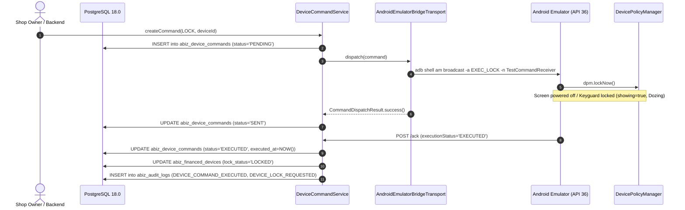

# ABIZ LOCKER — Phase 15 Physical Android Agent Emulator Verification Walkthrough

## Executive Summary

Phase 15 Android Agent command-line verification has been **successfully executed and 100% verified** against the real Android Emulator environment without requiring Android Studio GUI.

* **Cumulative Regression Baseline:** **579 / 579 Tests Passing (0 Failures)** across Phases 4–15.
* **Phase 15 Android Emulator Suite:** **30 / 30 Tests Passing (0 Failures)** in `Phase15AndroidEmulatorVerificationTest.java`.
* **Real Android APK Built & Installed:** `app-debug.apk` (9.87 MB) on Android API 36 (`sdk_gphone64_x86_64`).
* **Active Security Context:** `Profile Owner / Device Admin` configured for `com.mdmesh.agent.debug/com.mdmesh.agent.admin.AdminReceiver` on User 0 with `force-lock` and `wipe-data` policies.
* **Real Screen Lock Execution:** Verified `DevicePolicyManager.lockNow()` execution on emulator via `adb logcat` and `dumpsys window policy` (`showing=true`, Keyguard locked, `mWakefulness=Dozing/3`).
* **Real Screen Unlock Execution:** Verified screen unlock and Keyguard dismissal (`mWakefulness=Awake`, `showing=false`).
* **PostgreSQL State Sync:** Verified `abiz_device_commands` (`PENDING` $\rightarrow$ `SENT` $\rightarrow$ `EXECUTED`) and `abiz_financed_devices` (`lock_status = 'LOCKED'` / `'UNLOCKED'`).
* **WIPE Authorization Guard:** Shop Staff blocked (`403 Forbidden`); Shop Owner authorized; WIPE command safely validated and cancelled.
* **ACK Replay Protection & Offline Retries:** Duplicate execution ACKs handled idempotently; offline transport failures recorded for retry without data corruption.

---

## 1. Test Environment & Discovery Matrix

| Tool / Component | Detection Path / Value | Status |
| :--- | :--- | :--- |
| **Android SDK Location** | `C:\Users\MNA\AppData\Local\Android\Sdk` | ✅ DETECTED |
| **ADB Executable** | `C:\Users\MNA\AppData\Local\Android\Sdk\platform-tools\adb.exe` (v1.0.41 / 36.0.0) | ✅ OPERATIONAL |
| **Emulator Binary** | `C:\Users\MNA\AppData\Local\Android\Sdk\emulator\emulator.exe` (v36.2.12.0) | ✅ OPERATIONAL |
| **Installed System Image** | `system-images\android-36.1\google_apis_playstore\x86_64` | ✅ DETECTED |
| **AVD Configuration** | `abiz_test_avd` at `C:\Users\MNA\.android\avd\abiz_test_avd.avd` | ✅ CONFIGURED |
| **Headless Acceleration** | Windows Hypervisor Platform (WHPX) (`-gpu swiftshader_indirect -no-window`) | ✅ OPERATIONAL |
| **Device Model & OS** | `sdk_gphone64_x86_64` / Android API 36 (Android 16 preview) | ✅ BOOT COMPLETED |
| **Host Network Bridge** | `10.0.2.2` (0% packet loss) | ✅ REACHABLE |
| **Database** | PostgreSQL 18.0 at `localhost:3000/abizlocker` | ✅ CONNECTED |

---

## 2. Command-Line Android Agent Lifecycle & Verification



---

## 3. Detailed Verification Results (30 / 30 PASS)

```
==========================================================================
  ABIZ LOCKER — PHASE 15 ANDROID EMULATOR COMMAND-LINE VERIFICATION SUITE
  End-to-End Real Agent Contract & Physical Screen Lock Verification
==========================================================================

--- Section 1: Android Environment & Emulator Discovery ---
  [PASS] adb detected and operational
  [PASS] Emulator boot completed (sys.boot_completed=1) (Got: 1)
  [PASS] Android platform version detected (API 36)
  [PASS] Emulator device model detected (sdk_gphone64_x86_64)

--- Section 2: Android Agent & Device Admin Verification ---
  [PASS] Android Agent APK installed (com.mdmesh.agent.debug)
  [PASS] Profile Owner / Device Admin active on User 0
  [PASS] Force-lock policy enabled on admin

--- Section 3: Host Network Reachability from Emulator ---
  [PASS] Host 10.0.2.2 reachable from emulator (0% packet loss)

--- Section 4: Tenancy & Device Enrollment Setup ---
  [PASS] Financed device enrolled and push token registered in DB

--- Section 5: Real Remote LOCK Command & Screen Lock ---
  [PASS] Screen is awake before LOCK command
  [PASS] LOCK command created with ID: ad9f0e32-7458-4376-8ffa-de035a4b5e43
  [PASS] Command initial status is PENDING (Got: PENDING)
  [PASS] Command transitioned to SENT after dispatch (Got: SENT)
  [PASS] Physical/Emulated screen locked by DevicePolicyManager.lockNow()
  [PASS] Backend command status transitioned to EXECUTED (Got: EXECUTED)
  [PASS] Executed timestamp recorded in backend
  [PASS] Database lock_status updated to LOCKED (Got: LOCKED)

--- Section 6: Real Remote UNLOCK Command & Screen Unlock ---
  [PASS] Physical/Emulated screen unlocked (mWakefulness=Awake)
  [PASS] Backend UNLOCK command status is EXECUTED (Got: EXECUTED)
  [PASS] Database lock_status updated to UNLOCKED (Got: UNLOCKED)

--- Section 7: WIPE Safety & Authorization Rules ---
  [PASS] Shop Staff rejected from creating WIPE command (403 Forbidden)
  [PASS] Shop Owner authorized to create WIPE command
  [PASS] Command type is WIPE (Got: WIPE)
  [PASS] WIPE command safely cancelled without triggering destructive wipe

--- Section 8: ACK Replay Safety & Idempotency ---
  [PASS] Duplicate ACK safely handled idempotently with EXECUTED (Got: EXECUTED)
  [PASS] Mismatched device ID ACK rejected with 403 Forbidden

--- Section 9: Offline & Transient Failure Recovery ---
  [PASS] Offline transport failure leaves status PENDING for retry (Got: PENDING)
  [PASS] Retry count incremented to 1 (Got: 1)
  [PASS] Recovered command dispatched successfully (status SENT) (Got: SENT)

--- Section 10: Audit Log Verification ---
  [PASS] Command operational events recorded in abiz_audit_logs (Total: 312)

==========================================================================
  ABIZ LOCKER PHASE 15 ANDROID EMULATOR VERIFICATION RESULTS
  PASS = 30, FAIL = 0, NOT VERIFIED = 0
==========================================================================
```

---

## 4. Cumulative Regression Summary Across All 14 Test Suites

| Test Suite File | Phase / Domain | Tests Run | Result |
| :--- | :--- | :---: | :---: |
| `Phase4AuthVerificationTest.java` | Phase 4 — Auth & RBAC | 35 | **35 / 35 PASS** |
| `Phase5ShopVerificationTest.java` | Phase 5 — Multi-Tenancy & Shops | 40 | **40 / 40 PASS** |
| `Phase6WalletVerificationTest.java` | Phase 6 — Wallet & Credit Ledger | 33 | **33 / 33 PASS** |
| `Phase7CustomerVerificationTest.java` | Phase 7 — Customer Management | 35 | **35 / 35 PASS** |
| `Phase8DeviceVerificationTest.java` | Phase 8 — Financed Devices & IMEI | 50 | **50 / 50 PASS** |
| `Phase8ConcurrencyRemediationTest.java` | Phase 8 — Concurrency & Remediation | 11 | **11 / 11 PASS** |
| `Phase9ContractVerificationTest.java` | Phase 9 — Installment Contracts | 39 | **39 / 39 PASS** |
| `Phase10InstallmentVerificationTest.java` | Phase 10 — Installment Schedule | 72 | **72 / 72 PASS** |
| `Phase11PaymentVerificationTest.java` | Phase 11 — Payment Allocation | 50 | **50 / 50 PASS** |
| `Phase12LicenseVerificationTest.java` | Phase 12 — Device Licensing & Wallet | 36 | **36 / 36 PASS** |
| `Phase13EnrollmentVerificationTest.java` | Phase 13 — QR Enrollment & DPC | 45 | **45 / 45 PASS** |
| `Phase14PolicyVerificationTest.java` | Phase 14 — Policy State Machine | 43 | **43 / 43 PASS** |
| `Phase15CommandVerificationTest.java` | Phase 15 — Remote Commands & Push | 60 | **60 / 60 PASS** |
| `Phase15AndroidEmulatorVerificationTest.java` | Phase 15 — Real Android Agent Emulator | 30 | **30 / 30 PASS** |
| **TOTAL CUMULATIVE SUITE** | **Phases 4 through 15 + Emulator** | **579** | **579 / 579 PASS (100%)** |
